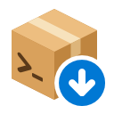
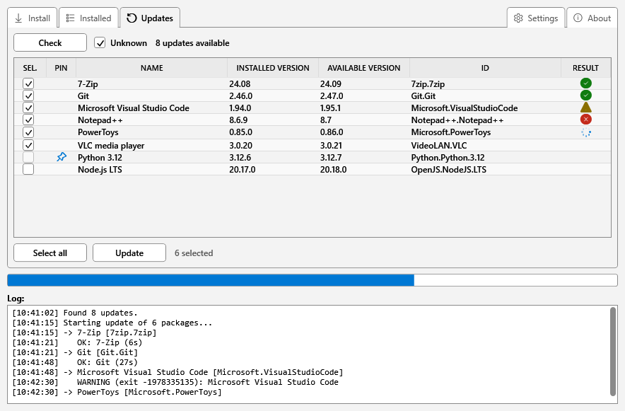
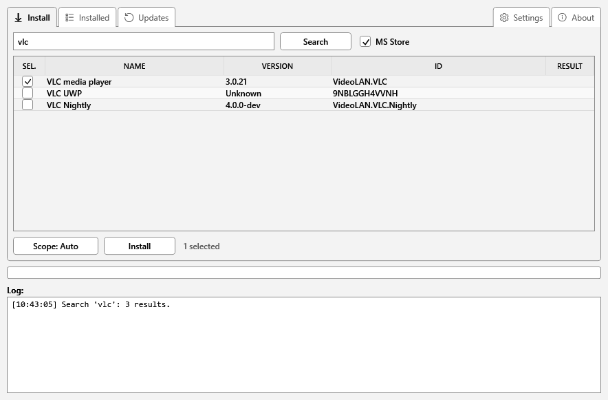
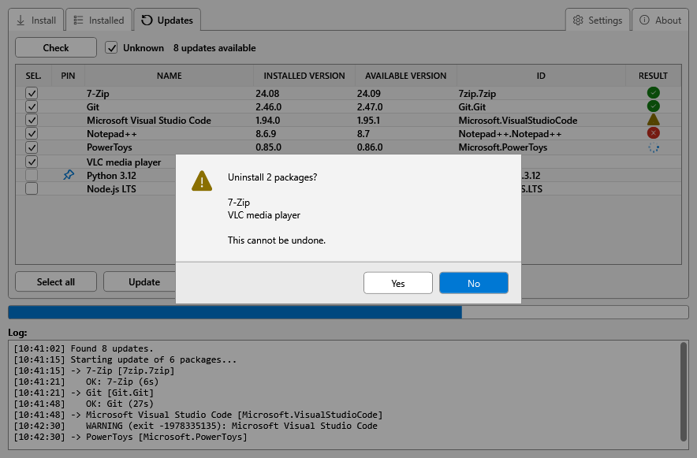
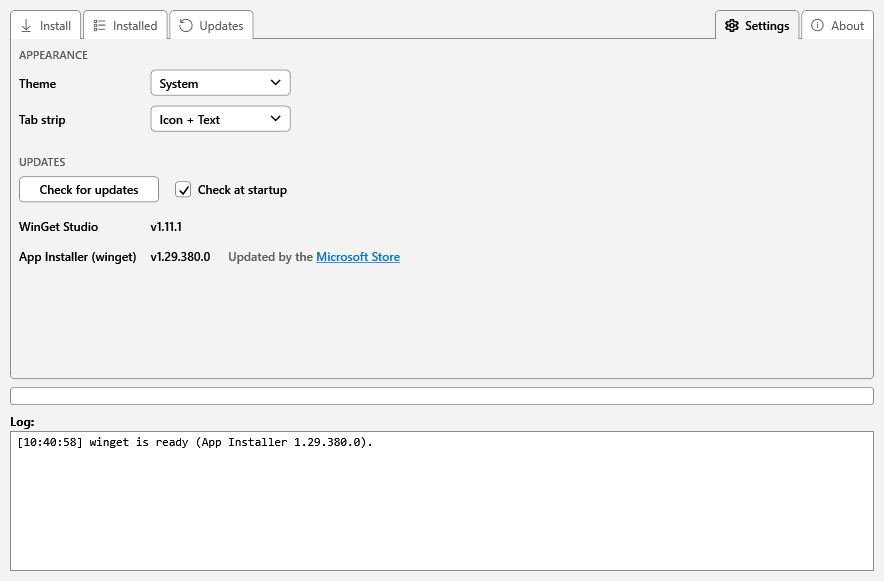

<div align="center">



<h1>WinGet Studio</h1>

<p><strong>A Windows desktop front end for <code>winget</code>.</strong><br>
Update, install, uninstall, pin, export and import — all from one table with checkboxes.</p>

[](https://github.com/FedeB2160/WinGetStudio/releases/latest)
[](https://github.com/microsoft/winget-pkgs/tree/master/manifests/f/FedeB2160/WinGetStudio)
[](https://github.com/FedeB2160/WinGetStudio/releases)
[](https://github.com/FedeB2160/WinGetStudio/actions/workflows/ci.yml)
[](LICENSE)


[**Download**](https://github.com/FedeB2160/WinGetStudio/releases/latest) · [Using it](#using-it) · [Troubleshooting](docs/TROUBLESHOOTING.md) · [Changelog](CHANGELOG.md)

</div>

<picture>
  <source media="(prefers-color-scheme: dark)" srcset="docs/images/updates-dark.png">
  
</picture>

## Features

- **Update** what has a newer version: tick, press **Update**, and each row shows its own outcome.
- **Install** something new by searching as you type, from the winget catalogue and, if you want, the Microsoft Store.
- **List and uninstall** what is already on the machine, including programs installed without winget.
- **Pin** what must not be touched, so updates skip it.
- **Export / import** the whole package list to rebuild a machine.
- **Keeps winget itself working**: installs it if it is missing, and shows when App Installer has a newer version.
- Light and dark theme, following Windows if you like. No telemetry, no branding, nothing to set up.

## Requirements

- **Windows 10 (1809 or later) or 11** with **winget**, which comes in the *App Installer* package.
  - If winget is missing, the app offers to install it at startup. It first registers the App Installer that comes with Windows; if there is none, it downloads App Installer and its dependencies from [github.com/microsoft/winget-cli](https://github.com/microsoft/winget-cli/releases) (a few hundred MB, checked against the published SHA-256). Saying no closes the app.
- **Administrator rights**: installing and removing software needs them, so the app asks for elevation when it starts.

## Getting it

From the [latest release](https://github.com/FedeB2160/WinGetStudio/releases/latest), pick one:

| | File | What you get |
|---|---|---|
| **Installer** (recommended) | `WinGetStudio_Setup.exe` | Installs for all users, adds a Start menu entry (a desktop one is optional) and shows up in Windows Settings to uninstall. Uninstalling keeps your preferences. |
| **Portable** | `WinGetStudio.exe` | Runs from anywhere and installs nothing. Nothing is written outside the registry key holding your preferences. |

It is also in the winget catalogue:

```powershell
winget install FedeB2160.WinGetStudio
```

Since 1.11.0 that runs the installer: the Start menu entry and the uninstall entry in Windows Settings come with it, and `winget upgrade` updates it. If you installed an earlier version with winget, `winget upgrade FedeB2160.WinGetStudio` replaces the portable copy, and its `WinGetStudio` command-line alias, with the installed one.

> [!NOTE]
> **Windows will warn about an unknown publisher.** The exe *is* signed, but with a self-signed certificate. Choose *More info* → *Run anyway*, or see [Troubleshooting](docs/TROUBLESHOOTING.md#windows-warns-about-an-unknown-publisher) to make the signature trusted.

> [!TIP]
> **If an antivirus quarantines the executable**, or the app vanishes while running, it is a known false positive of Microsoft Defender on PowerShell compiled into an exe. [Troubleshooting](docs/TROUBLESHOOTING.md#an-antivirus-quarantines-the-executable) explains how to confirm it and get the app back.

## Using it

The window has three tabs, plus **Settings** and **About** pinned to the right of the strip. **Unknown**, **MS Store** and **Scope** are remembered between launches, next to the theme. The **progress bar and the log at the bottom stay visible from every tab**, so you can start a long update, switch tab, and still see how it is going.

### Updates

1. **Check** lists what has a newer version available.
   - **Unknown** (off by default) also lists packages whose installed version winget cannot determine. It applies to the *next* check.
2. Tick what you want, or **Select all**.
3. **Update** upgrades them one at a time. Each row shows its own outcome, and slow installers are never cut off: the log writes a line every 30 seconds so you can see it is still working.
   - While the queue runs, **Update** reads **Cancel**. Pressing it lets the package in progress finish and then stops, so nothing is interrupted halfway through an installer; the packages that never ran keep their tick and an empty result.
4. When the queue ends, **Update** is greyed until you press **Check** again. The versions on screen describe the machine as it was before, so running the queue on them would report failures for packages that had in fact succeeded. The list is not rebuilt automatically on purpose: that would wipe the outcome of each row, which is the point of the Result column.

The list stays scrollable while updating (the ticks and the pin entries are greyed, not the list), and columns can be resized by dragging their edge in the header.

While a scan is running the progress bar is **indeterminate**: a scan has no progress to report, and a bar sitting at zero looks like something stuck. It shows real progress only for a queue, which knows how many packages it has.

#### What the Result column means

| Icon | Meaning |
|:---:|---|
| ⏳ | in progress |
| ✅ | done |
| ⚠️ | done, with a warning: usually "a reboot is needed" or "already installed" |
| ❌ | failed: hover for the code, full detail in the log |

### Install

<picture>
  <source media="(prefers-color-scheme: dark)" srcset="docs/images/install-dark.png">
  
</picture>

Type a name and results appear **as you type**. There is no autocomplete popup: the results list itself is the suggestion, so you see version and ID before choosing.

1. Type **at least 3 characters**. The search runs against the local winget catalogue, which is fast.
2. **MS Store** also searches the Microsoft Store. Since that goes online and is much slower, it only applies when you press <kbd>Enter</kbd> or **Search**, never while typing.
3. **Scope** chooses who the package is installed for: `Auto` lets winget decide, `Machine` installs for all users, `User` only for you.
4. Tick rows and press **Install**, or **double click a row** to install just that one.

> [!NOTE]
> The app runs elevated. If you elevated with a *different* account than the one you are signed in with, a per-user package ends up in that other profile. The log warns you once when that can happen.

### Installed

The inventory of what is on the machine, loaded the first time you open the tab.

1. The **filter box** narrows the list by name or ID as you type.
2. Tick rows and press **Uninstall**. A confirmation lists exactly what will be removed, and defaults to *No*: a stray <kbd>Enter</kbd> cannot delete anything.
   - If the filter is hiding a package you had ticked, both the counter and the confirmation say so, so nothing is removed off screen.
3. **Export...** saves the list of installed packages to a `.json` file. **Import...** installs the packages a file describes: the quick way to set up a new machine.

Packages you installed without winget appear here too, with IDs like `ARP\Machine\X64\Android Studio`, and can be uninstalled like any other. winget refuses to uninstall some per-user programs from an elevated app; WinGet Studio then repeats the uninstall without elevation, and a console window shows while it runs.

After an uninstall the list is not rebuilt automatically, so you can read the outcome of each row. Press **Refresh** when you are done.

### Pinning

A pin tells winget to leave a package alone until you remove the pin: for the one that keeps reappearing and that you do not want touched. Pins made here are *blocking*: winget refuses to upgrade the package even when asked for it by name, from this app or from the command line. Pins created elsewhere keep their own type; this app skips them on update anyway.

**Right click a row** in Updates or Installed → *Pin highlighted* or *Remove pin from highlighted*. It works on the highlighted rows, not the ticked ones, and the entries say so. A pinned package shows a 📌 icon and is skipped by updates, including *Select all*. It can still be uninstalled: a pin blocks upgrades, not removal.

### Confirmations

Every confirmation and message opens in the app's own style, over the window, which dims behind it.

<picture>
  <source media="(prefers-color-scheme: dark)" srcset="docs/images/dialog-dark.png">
  
</picture>

The highlighted button is the one <kbd>Enter</kbd> presses, and on every confirmation it is **No**. <kbd>Esc</kbd> and the close button answer No as well. The text can be selected and copied.

### Settings

<picture>
  <source media="(prefers-color-scheme: dark)" srcset="docs/images/settings-dark.png">
  
</picture>

The **Settings** tab, on the right of the strip next to About, is a tab like the others, so the progress bar and the log stay visible while you are in it.

- **Theme**: `Light`, `Dark`, or `System` to follow Windows (which it keeps following while the window is open).
- **Tab strip**: whether the tabs show their icon, their name, or both. Every tab also has a tooltip saying what it is for.
- **Updates**: **Check for updates** and **Check at startup** at the top, for both entries below them: **WinGet Studio** and **App Installer (winget)**, each with its version, and an update button when there is a newer one (see [Automatic updates](#automatic-updates)). The startup check is on by default and can be turned off: it is one anonymous call to the GitHub API every time the app starts, two where the Microsoft Store does not update winget. The **Check for updates** button always works regardless.

### About

Its own tab, at the very right end of the strip: what the app does function by function, and links to the source, the release notes, the licence and where to report a bug.

### Keyboard

| Keys | Does |
|---|---|
| <kbd>F5</kbd> | rescans the active tab, Updates or Installed; nothing on the others |
| <kbd>Ctrl</kbd>+<kbd>F</kbd> | jumps to the Install tab with the cursor in the search box |
| <kbd>Enter</kbd> | in the search box, searches the Microsoft Store too when **MS Store** is ticked; in a confirmation, presses the highlighted button (No) |
| <kbd>Esc</kbd> | in a confirmation, answers No |

## Automatic updates

At startup the app checks GitHub for a newer release. If there is one, an **Update to vX.Y.Z** button appears in the Settings tab, and the log says so. Nothing is downloaded until you ask: the button explains what will be downloaded and from where, and the file is verified against the checksum published with the release.

- A copy installed with the setup runs the new installer, which closes WinGet Studio, updates it and reopens it.
- A portable copy replaces itself and restarts.
- A copy installed with winget is updated with `winget upgrade FedeB2160.WinGetStudio`.

If there is no newer release, no network, or you are running from source, the check says nothing at all. You can always ask explicitly with **Check for updates**, which does report the outcome either way.

### winget itself

The **App Installer (winget)** entry in Settings shows the installed version of App Installer, the package that carries winget. Who updates it depends on the machine:

- **Where the Microsoft Store is available and allowed to update apps**, it keeps App Installer up to date on its own, and the entry links to the Store's *Downloads and updates* page.
- **Elsewhere** (Windows LTSC and Server, Windows Sandbox, a Store turned off by policy), the startup check also asks GitHub for the latest winget release. If it is newer, an **Update to vX.Y.Z** button appears: it downloads App Installer and its dependencies from github.com/microsoft/winget-cli (about 300 MB), checks them against the published SHA-256 and installs them. If winget is running somewhere else at that moment, the new version starts when it closes.

## Building it, and how it works inside

See **[DEVELOPMENT.md](DEVELOPMENT.md)**: project layout, how the single-file exe is built from the modules, signing, publishing a release, the test suite, and the design decisions worth knowing before changing the code.

Version history is in **[CHANGELOG.md](CHANGELOG.md)**. Problems that are not bugs, and what to do about them, are in **[Troubleshooting](docs/TROUBLESHOOTING.md)**.
